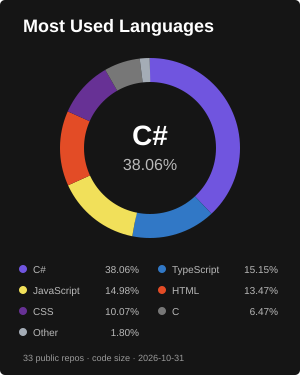

# Gboun Marvellous Emmanuel

Software developer based in Nigeria. I build performant software applications with a focus on creating marvellous experiences for users.

My background is in Electrical/Electronic Engineering, with a focus on Electronics.

I'm open to collaborating on frontend and backend projects.

**I am actively exploring DevOps and AI engineering.**

## Tech stack

<picture>
  <source media="(max-width: 767px)" srcset="./assets/top-languages-compact.svg" />
  
</picture>

| Area | Stack |
| :--- | :--- |
| **Languages** | JavaScript, TypeScript, C# |
| **Frontend** | React, Next.js, Angular, Blazor |
| **Backend** | Node.js, Express, NestJS, .NET |
| **Databases** | PostgreSQL, MongoDB, MySQL |

## Connect

[Portfolio](https://lankiman.xyz) · [Email](mailto:marvellousgboun@gmail.com) · [LinkedIn](https://www.linkedin.com/in/marvellous-gboun) · [X](https://x.com/Lanki_Man)

Discord: `lankiman`

  "The only way to do great work is to love what you do." - Steve Jobs

